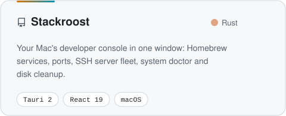
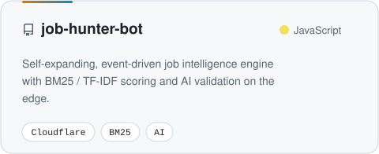
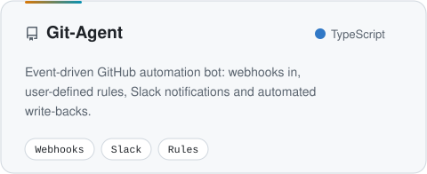
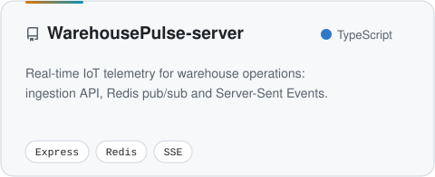
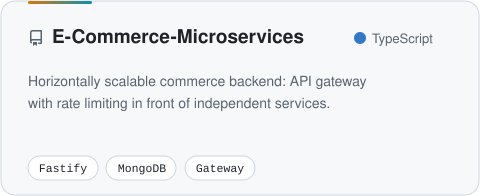
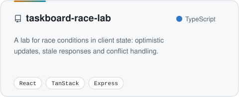

<a href="https://portfolio-v1-arpit-patidars-projects-8854eb72.vercel.app">
  <picture>
    <source media="(prefers-color-scheme: dark)" srcset="assets/header-dark.svg">
    
  </picture>
</a>

  
  
  
  
  

 

<picture>
  <source media="(prefers-color-scheme: dark)" srcset="assets/section-about-dark.svg">
  
</picture>

<picture>
  <source media="(prefers-color-scheme: dark)" srcset="assets/terminal-dark.svg">
  
</picture>

  

<picture>
  <source media="(prefers-color-scheme: dark)" srcset="assets/section-work-dark.svg">
  
</picture>

  <a href="https://github.com/Arpitpatidar00/Stackroost"><picture><source media="(prefers-color-scheme: dark)" srcset="assets/cards/Stackroost-dark.svg"></picture></a>
  <a href="https://github.com/Arpitpatidar00/job-hunter-bot"><picture><source media="(prefers-color-scheme: dark)" srcset="assets/cards/job-hunter-bot-dark.svg"></picture></a>
  <a href="https://github.com/Arpitpatidar00/Git-Agent"><picture><source media="(prefers-color-scheme: dark)" srcset="assets/cards/Git-Agent-dark.svg"></picture></a>
  <a href="https://github.com/Arpitpatidar00/WarehousePulse-server"><picture><source media="(prefers-color-scheme: dark)" srcset="assets/cards/WarehousePulse-server-dark.svg"></picture></a>
  <a href="https://github.com/Arpitpatidar00/E-Commerce-Microservices"><picture><source media="(prefers-color-scheme: dark)" srcset="assets/cards/E-Commerce-Microservices-dark.svg"></picture></a>
  <a href="https://github.com/Arpitpatidar00/taskboard-race-lab"><picture><source media="(prefers-color-scheme: dark)" srcset="assets/cards/taskboard-race-lab-dark.svg"></picture></a>

 

<picture>
  <source media="(prefers-color-scheme: dark)" srcset="assets/section-path-dark.svg">
  
</picture>

| When | Role | Highlights |
| :-- | :-- | :-- |
| **Aug 2025 → now** | **Software Engineer, Full-Stack** · Metaverse Ventures *(remote)* | Cross-chain treasury — swap / bridge / yield execution behind one quote-and-settlement layer · Privy embedded wallets · multi-chain virtual accounts with automated fund routing |
| **Jul 2024 → Aug 2025** | **Associate Software Developer** · Amenses Innovation | Turborepo monorepo with shared type & service packages · layered Node.js + TypeScript backends · **~30% lower query latency** via MongoDB indexes, aggregation pipelines and TanStack Query caching |
| **Mar 2024 → Jul 2024** | **Software Developer Intern** · Amenses Innovation | Shipped 2+ MERN products · ran sprint planning and code reviews · automated **2K+ monthly** auth emails |
| **Aug 2023 → Nov 2023** | **Software Developer Trainee** · Amenses Innovation | First production codebase |

 

<picture>
  <source media="(prefers-color-scheme: dark)" srcset="assets/section-stack-dark.svg">
  
</picture>

   
   
  

| | |
| :-- | :-- |
| **Frontend** | React · Next.js · Redux · TanStack Query · MUI · shadcn/ui · Tailwind |
| **Backend** | Node.js · NestJS · Express · Fastify · REST · GraphQL · WebSocket · SSE |
| **Data** | MongoDB · Supabase · Redis · Prisma |
| **Web3 & Payments** | Privy embedded wallets · cross-chain swap / bridge / yield · stablecoins · Stripe · Razorpay |
| **Infra** | AWS EC2 / S3 · Cloudflare Workers · Vercel · GitHub Actions · Turborepo · Nx |
| **Native** | Rust · Tauri 2 |

 

<picture>
  <source media="(prefers-color-scheme: dark)" srcset="assets/section-shipped-dark.svg">
  
</picture>

  
  
  
  
  
   
  
  
  
  

 

<picture>
  <source media="(prefers-color-scheme: dark)" srcset="assets/section-activity-dark.svg">
  
</picture>

<picture>
  <source media="(prefers-color-scheme: dark)" srcset="https://github-readme-activity-graph.vercel.app/graph?username=Arpitpatidar00&bg_color=0d1117&color=8b949e&line=f5a524&point=22d3ee&area=true&area_color=f5a524&hide_border=true&radius=12&custom_title=Contributions%20%C2%B7%20last%2031%20days">
  
</picture>

🏆 Winner — Code Hunter 2024 &nbsp;·&nbsp; 🥉 3rd place — Web Dev Hackathon 2024 &nbsp;·&nbsp; 🎓 B.Tech CSE, Indore

<picture>
  <source media="(prefers-color-scheme: dark)" srcset="assets/footer-dark.svg">
  
</picture>
